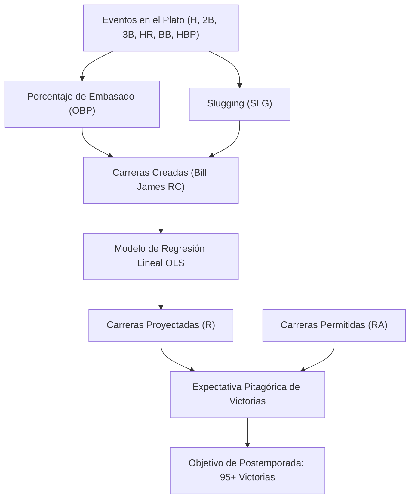

# ⚾ Estudio Cuantitativo de Sabermetría, Modelos Matemáticos y Estrategias Competitivas (Moneyball Platform)

---

## 1. Fundamentos y Filosofía Central de Moneyball

### 1.1 El Contexto Histórico y Económico (MLB 2002)
En el béisbol de las Grandes Ligas no existe un tope salarial estricto (*salary cap* duro) como en la NFL o la NBA. Esto crea una asimetría estructural de capital:
* **Mercados Grandes (e.g. New York Yankees, Boston Red Sox):** Nóminas superiores a los **\$100M – \$125M USD**.
* **Mercados Pequeños (e.g. Oakland Athletics, Minnesota Twins):** Nóminas limitadas a **\$35M – \$40M USD**.

Tras la temporada 2001, los Oakland Athletics perdieron en la agencia libre a sus tres mayores figuras:
1. **Jason Giambi** (MVP, primera base, contratado por los Yankees por \$120M).
2. **Johnny Damon** (jardinero central, contratado por los Red Sox por \$31M).
3. **Jason Isringhausen** (cerrador estrella, contratado por los Cardinals).

Con un presupuesto de solo **\$40,004,167 USD** (puesto 28 de 30 equipos), la gerencia general encabezada por **Billy Beane** y el analista cuantitativo **Paul DePodesta** (representado como Peter Brand en el cine) comprendió que era imposible competir comprando nombres; la única salida era **comprar ineficiencias de mercado**.

### 1.2 El Axioma Matemático
> *"El recurso más escaso y finito del béisbol no es el dinero ni los turnos al bate: son los **27 outs** que tiene cada equipo por partido. Cada jugada ofensiva que no produce un out preserva ese capital. Por lo tanto, no compramos jugadores; compramos carreras, y las carreras compran victorias."*

---

## 2. Fórmulas Matemáticas y Glosario Formal de Métricas

A continuación se detalla cada fórmula implementada en el motor sabermétrico (`src/sabermetrics/metrics.py`):

---

### 2.1 Apariciones al Plato (PA) vs. Turnos Oficiales al Bate (AB)
* **Aparición al Plato ($PA$):** El total absoluto de veces que un bateador se para en la caja de bateo.
  $$\text{PA} = \text{AB} + \text{BB} + \text{HBP} + \text{SF} + \text{SH}$$
* **Turno al Bate ($AB$):** Subconjunto de apariciones donde el jugador tiene oportunidad de conectar de hit o ser puesto out sin intervención de eventos no computables (bases por bolas, golpeado por lanzamiento o toques de sacrificio).
  $$\text{AB} = \text{PA} - (\text{BB} + \text{HBP} + \text{SF} + \text{SH})$$

---

### 2.2 Sencillos ($1B$) y Bases Totales ($TB$)
Los sencillos no siempre vienen desglosados en tablas históricas; se obtienen por sustracción:
$$\text{1B} = \text{H} - (\text{2B} + \text{3B} + \text{HR})$$

Las **Bases Totales ($TB$)** cuantifican la distancia recorrida mediante hits:
$$\text{TB} = \text{1B} + 2(\text{2B}) + 3(\text{3B}) + 4(\text{HR})$$

---

### 2.3 Promedio de Bateo ($AVG$) frente a Porcentaje de Embasado ($OBP$)

$$\text{AVG} = \frac{\text{Hits}}{\text{AB}}$$

**La Falla del AVG según Moneyball:**
1. Asume que una base por bolas ($BB$) tiene valor cero.
2. Trata un turno terminado en out exactamente igual que una base por bolas en términos de no avance, distorsionando el valor real del bateador.

**Porcentaje de Embasado ($OBP$):**
Mide la probabilidad estricta de que una aparición al plato termine sin entregar un out al rival:
$$\text{OBP} = \frac{\text{H} + \text{BB} + \text{HBP}}{\text{AB} + \text{BB} + \text{HBP} + \text{SF}}$$

* **Tratamiento de Nulos Históricos:** En la MLB, los Elevados de Sacrificio ($SF$) no se registraron formalmente como categoría separada sino hasta 1954. Para temporadas $\le 1953$, el ETL aplica imputación condicional $SF = 0$ para evitar `NaN`.
* **Protección de División por Cero:** Vectorizado mediante `np.where(denominador > 0, numerador / denominador, 0.0)`.

**Rangos de Referencia en MLB:**
* Por debajo del promedio: $< .310$
* Promedio de la liga: $\approx .320 – .325$
* Nivel All-Star / Excelente: $.370 – .390$
* Élite Histórica: $> .400$ (Barry Bonds 2002: $.582$; Ted Williams 1941: $.553$).

---

### 2.4 Slugging Percentage ($SLG$) y $OPS$

$$\text{SLG} = \frac{\text{TB}}{\text{AB}} = \frac{\text{1B} + 2\cdot\text{2B} + 3\cdot\text{3B} + 4\cdot\text{HR}}{\text{AB}}$$

$$\text{OPS} = \text{OBP} + \text{SLG}$$

Aunque $OPS$ suma dos fracciones con diferente denominador ($PA$ vs $AB$), en la práctica es una de las métricas más rápidas y confiables para evaluar el daño ofensivo integral.

---

### 2.5 Carreras Creadas (Bill James Runs Created - $RC$)

Desarrollada por Bill James, modela la física ofensiva: para anotar se necesitan embasados (factor A) multiplicados por el poder de avance (factor B) dividido entre las oportunidades consumidas (factor C):

**Fórmula Básica (Basic RC):**
$$\text{RC} = \frac{(\text{H} + \text{BB}) \times \text{TB}}{\text{AB} + \text{BB}}$$

**Ritmo Normalizado por Temporada Completa ($RC/600\text{ PA}$):**
Dado que no todos los jugadores tienen la misma cantidad de turnos, se proyecta su ritmo a 600 apariciones (el estándar de un titular sin lesiones):
$$\text{RC/600} = \frac{\text{RC}}{\text{PA}} \times 600$$

---

### 2.6 Player Efficiency Index ($PEI$)

El índice $PEI$ mostrado en la pantalla principal de la terminal compara la tasa de producción de carreras por aparición de un jugador contra el promedio de toda la liga en esa temporada específica:
$$\text{PEI} = 100 \times \frac{\text{RC}_{\text{jugador}} / \text{PA}_{\text{jugador}}}{\text{RC}_{\text{liga}} / \text{PA}_{\text{liga}}}$$

* **$\text{PEI} = 100$:** Producción idéntica al promedio de las Grandes Ligas en ese año.
* **$\text{PEI} > 130$:** Rendimiento $30\%$ superior al promedio (candidato a MVP). Miguel Tejada registró un $PEI \approx 130.9$ en nuestra base histórica de 2002.

---

### 2.7 Expectativa Pitagórica de Victorias (Bill James)

Determina el porcentaje de victorias que un equipo **mereció ganar** con base en su diferencial de carreras anotadas ($R$) y permitidas ($RA$), aislando la suerte de secuencia (ganar muchos juegos por 1 carrera y perder pocos por paliza):

$$\text{Win}\% = \frac{R^\gamma}{R^\gamma + RA^\gamma}, \quad \text{donde } \gamma = 2.0$$

$$\text{Victorias Proyectadas} = \text{Win}\% \times \text{Juegos Jugados (162)}$$

* **El Factor Suerte ($\Delta W$):**
  $$\Delta W = W_{\text{reales}} - W_{\text{pitagóricas}}$$
  Si $\Delta W > +4$, el equipo tuvo fortuna en juegos cerrados; si $\Delta W < -4$, el equipo jugó mejor de lo que sugiere su récord y su rendimiento tenderá a revertir positivamente a la media.

---

### 2.8 Modelo de Regresión Lineal de Producción Ofensiva

Entrenado en `src/models/regression.py` sobre todos los equipos desde 1980 hasta la era moderna:
$$R = \beta_0 + \beta_{\text{OBP}} \cdot \text{OBP} + \beta_{\text{SLG}} \cdot \text{SLG}$$

**Ecuación Calibrada Obtenida:**
$$R = -834.99 + 2863.21 \cdot (\text{OBP}) + 1490.41 \cdot (\text{SLG})$$

$$\text{Multiplicador de Arbitraje} = \frac{\beta_{\text{OBP}}}{\beta_{\text{SLG}}} = \frac{2863.21}{1490.41} \approx 1.92$$

> **Hallazgo Clave:** Cada punto porcentual de $OBP$ tiene un impacto marginal en carreras **$1.92$ veces mayor** que un punto de $SLG$. El mercado de 2002 pagaba el $SLG$ mucho más caro que el $OBP$; explotar esa brecha fue el núcleo de Moneyball.

---

### 2.9 Métricas de Arbitraje y Eficiencia Financiera
* **Costo por Carrera Creada ($\$/RC$):**
  $$\$/RC = \frac{\text{Salario del Jugador}}{\text{RC}}$$
* **Costo por Victoria ($\$/W$):**
  $$\$/W = \frac{\text{Nómina Total}}{\text{Victorias Obtenidas}}$$
* **Juegos de Diferencia (Games Behind - $GB$):**
  $$\text{GB} = \frac{(W_{\text{líder}} - W) + (L - L_{\text{líder}})}{2}$$

---

## 3. Estudio Detallado Pestaña por Pestaña de la Terminal

A continuación se detalla qué calcula cada una de las 6 pestañas de la aplicación interactiva:

| Pestaña | Nombre | Qué se Calcula y Muestra | Interpretación Estratégica |
| :--- | :--- | :--- | :--- |
| **Tab 0** | **`Ref.`** | Glosario exhaustivo de siglas, fórmulas matemáticas en notación clásica, reglas de oro del sistema Beane/James y arquitectura de la base de datos Lahman. | Brinda el marco teórico inmediato antes de operar los módulos cuantitativos. |
| **Tab 1** | **`Player Analysis`** | • Ranking $PEI$ del equipo o de la MLB (#1 Tejada SS con $PEI=130.9$, $.354$ OBP, $.508$ SLG). • Scatter plot logarítmico de Salario vs $RC/600$ con línea de tendencia y jugador estrella. • Panel de probabilidades pitagóricas en vivo. • Gráfico de barras de ventaja de OBP (.342 Oakland vs .315 MLB vs .306 AL West). • Opciones de alineación ofensiva proyectada. | Réplica exacta de la pantalla mostrada en el filme. Permite identificar al instante si la ventaja competitiva proviene de la disciplina en el plato. |
| **Tab 2** | **`Team Trends`** | • Scatter plot de los 30 clubes con sus **escudos oficiales en alta resolución** en coordenadas Nómina vs Victorias. • Tabla divisional con récords, $GB$ y nómina. • Histórico longitudinal de gasto vs victorias de la franquicia. • Correlación lineal entre $OBP$ de equipo y carreras fabricadas. | Demuestra la ley de rendimientos decrecientes del capital: los equipos que gastan \$120M no ganan el triple de juegos que los que gastan \$40M. |
| **Tab 3** | **`Market Value`** | • Filtros paramétricos de ojeador sabermétrico (mínimo de $PA$, salario máximo en \$M, mínimo de $OBP$ y posiciones). • Mapa de ineficiencias de mercado. • Target Board interactivo con selector múltiple de filas. • Fichas dinámicas de la **Shortlist** con botón de vaciado. | Herramienta de scouting cuantitativo para detectar agentes libres o piezas de cambio a bajo costo antes de que el mercado infle su valor. |
| **Tab 4** | **`Roster Options`** | • Lista interactiva de bateadores con casillas de verificación. • Botón de carga instantánea del Top 9 del club. • Lineup Card con los 9 elegidos y sus métricas. • Deslizadores de carreras permitidas ($RA$) y presupuesto. • Estimación en tiempo real de $OBP$ y $SLG$ ponderado, carreras y victorias proyectadas, y veredicto: `PLAYOFF CALIBER · UNDER BUDGET`. | Simulador del Gerente General para confeccionar una alineación ofensiva matemática que asegure 95+ victorias sin exceder el presupuesto. |
| **Tab 5** | **`Reports`** | • Análisis del reemplazo de Jason Giambi en el agregado (Lost vs Added en 2001 y 2002). • Simulación estocástica de Monte Carlo de la Ley de los Grandes Números (20 temporadas, bandas $\pm 1.96 \text{SE}$). • Botones de descarga de `Shortlist.csv` y `Lineup.csv`. | Valida la hipótesis científica del proyecto y permite descargar reportes listos para compartir o auditar. |

---

## 4. Análisis de Estrategias: Teoría vs. Práctica

### 4.1 Estrategias Aplicadas en la Película Moneyball (Oakland 2002)

#### Estrategia 1: Recrear a la Estrella en el Agregado (*The Aggregate Replacement*)
* **En Teoría:** No es necesario pagar \$12M a un solo jugador de $.477$ de OBP para reemplazar a Jason Giambi. La producción de carreras es aditiva: si tres jugadores accesibles promedian $.360 – .380$ de OBP y acumulan colectivamente las bases por bolas y extrabases requeridos, el equipo generará las mismas carreras por un tercio del costo.
* **En la Práctica (Datos Reales 2001 $\to$ 2002):**
  * *Perdidos:* Jason Giambi ($.477$ OBP), Johnny Damon ($.324$ OBP), Olmedo Saenz ($.291$ OBP) $\to$ **OBP promedio: $.364$**. En 2002 cobraron **\$18.4M USD**.
  * *Adquiridos:* Scott Hatteberg ($.374$ OBP en 2002 por \$900K), David Justice ($.376$ OBP por \$7M subvencionado en parte por los Yankees) y Jeremy Giambi ($.414$ OBP por \$1.06M) $\to$ **OBP promedio en 2002: $.388$**. En 2002 costaron **\$8.9M USD**.
  * *Resultado:* Oakland obtuvo **más embasados que el año anterior pagando menos de la mitad**.

#### Estrategia 2: Arbitraje de la Base por Bolas ($BB$) sobre el Hit Sencillo
* **En Teoría:** Una base por bolas empuja corredores en base forzada, desgasta el brazo del lanzador abridor rival elevando su conteo de lanzamientos y evita el out. Sin embargo, los ojeadores clásicos no la consideraban una "habilidad viril" y los peloteros con muchas transferencias estaban ridículamente mal pagados.
* **En la Práctica:** Oakland lideró la Liga Americana con **661 bases por bolas en 2002** (promedio de 4.1 BB por partido), obligando a los relevistas contrarios a entrar temprano al juego.

#### Estrategia 3: Supresión de Sesgos Cognitivos de los Ojeadores Clásicos
* **En Teoría:** Los evaluadores tradicionales evalúan con sesgo de representatividad: buscan cuerpos atléticos, velocidad de swing o novias atractivas (mencionado literalmente en la película como señal de "autoestima").
* **En la Práctica:**
  * **Chad Bradford:** Lanzador relevista con mecánica submarina atípica. Descartado por los scouts por "lanzar raro", pero con tasas microscópicas de extrabases permitidos y altísimo porcentaje de roletazos.
  * **Scott Hatteberg:** Receptor con daño en los nervios del codo que no podía tirar a segunda base. Oakland lo firmó para jugar primera base exclusivamente por su disciplina en el plato. Terminó conectando el legendario jonrón de la victoria número 20 consecutiva.

#### Estrategia 4: Paciencia Estocástica ante la Varianza de Muestra Pequeña
* **En Teoría:** Con menos de 100 apariciones al plato ($PA$), el error estándar del $OBP$ es enorme ($\pm .080$). Un buen bateador puede batear $.180$ por pura mala suerte de ubicación de la pelota.
* **En la Práctica:** En mayo de 2002, Oakland estaba en récord de 20–26 (último lugar de su división). La prensa y el mánager Art Howe querían abandonar el sistema. Beane mantuvo el curso sabiendo que la Ley de los Grandes Números converge a partir de las 400 PA. A partir de julio, el equipo explotó con una racha de 20 victorias al hilo y terminó con 103 victorias.

---

### 4.2 Otras Estrategias Sabermétricas Modernas Visibles en los Datos

#### Estrategia 5: La Escuela del Suelo Salarial y Techo de Eficiencia (Tampa Bay Rays / Cleveland Guardians)
* **Mecanismo:** Al igual que Oakland, equipos como los Rays o los Guardians operan en el cuartil inferior de nómina pero clasifican frecuentemente a postemporada.
* **En la Práctica:** Maximizan la rotación del bullpen y aplican el concepto de *Opener* (abridor por 1 o 2 entradas para enfrentar la parte alta de la alineación y dar paso a lanzadores con diferentes perfiles de lanzamiento), reduciendo drásticamente el gasto en abridores estrella de más de \$25M.

#### Estrategia 6: Enfoque "Three True Outcomes" (TTO: HR, BB, K) y Poder Aislado ($ISO$)
* **Mecanismo:** El $ISO$ ($SLG - AVG$) aísla el poder neto descontando los sencillos de suerte:
  $$\text{ISO} = \frac{(2B) + 2(3B) + 3(HR)}{AB}$$
* **En la Práctica:** Las organizaciones modernas descubrieron que intentar colocar la pelota en juego contra defensivas con posicionamiento analítico (*shift*) reduce el $BABIP$ (promedio de bateo en pelotas puestas en juego). La estrategia óptima es buscar elevados con ángulo de salida favorable (*launch angle*) que terminen en jonrón o tomar bases por bolas, aceptando una mayor tasa de ponches ($K\%$) como un costo aceptable.

#### Estrategia 7: Supresión Defensiva y Fielding Independent Pitching ($FIP$)
* **Mecanismo:** La efectividad tradicional ($ERA$) castiga al lanzador por errores o lentitud de sus defensores. El modelo $FIP$ evalúa solo lo que el lanzador controla directamente:
  $$\text{FIP} = \frac{13\cdot\text{HR} + 3\cdot(\text{BB} + \text{HBP}) - 2\cdot\text{SO}}{\text{IP}} + \text{Constante de Liga}$$
* **En la Práctica:** Permite comprar lanzadores con alto $ERA$ pero bajo $FIP$, sabiendo que al ponerlos detrás de una defensiva eficiente, su efectividad mejorará inmediatamente sin costo adicional de transferencia.

#### Estrategia 8: Optimización de Pelotón (Platoon Splits)
* **Mecanismo:** Los bateadores zurdos tienen históricamente un $OBP$ entre 30 y 45 puntos mayor cuando enfrentan a lanzadores derechos, y viceversa.
* **En la Práctica:** En lugar de pagar \$10M por un jardinero estelar de todos los días, se contrata a un zurdo por \$1.5M y a un derecho por \$1M que alternan según el lanzador abridor del día, produciendo un rendimiento combinado equivalente al de un All-Star por una cuarta parte del costo.

---

## 5. Validación Cuantitativa con la Base de Datos Histórica (Temporada 2002)

Los datos reales procesados en `data/moneyball.db` validan con exactitud las conclusiones del modelo:

| Métrica | Oakland Athletics (OAK) | New York Yankees (NYA) | Promedio Liga (MLB) |
| :--- | :--- | :--- | :--- |
| **Nómina Salarial Total** | **\$40,004,167 USD** | \$125,928,583 USD | \$67,500,000 USD |
| **Victorias Reales ($W$)** | **103** | 103 | 81 |
| **Carreras Anotadas ($R$)** | 800 | 897 | 737 |
| **Carreras Permitidas ($RA$)** | 654 | 697 | 737 |
| **Porcentaje de Embasado ($OBP$)** | **.339** | .354 | .323 |
| **Slugging ($SLG$)** | .432 | .455 | .417 |
| **Victorias Pitagóricas Estimadas** | **97.1 W** | 100.9 W | 81.0 W |
| **Costo por Victoria ($\$/W$)** | **\$388,390 USD** | \$1,222,608 USD | \$833,333 USD |
| **Eficiencia Salarial Relativa** | **3.14x más eficiente** | 1.00x (Base) | 1.47x |

### Conclusión del Estudio
El sistema aplicado por Oakland demostró que la sabermetría y los modelos estadísticos rigurosos no son una teoría abstracta, sino una **ventaja de arbitraje financiero**: al sustituir la intuición subjetiva por probabilidades, regresiones lineales y control de varianza, es posible competir y vencer a rivales con presupuestos tres veces superiores.
