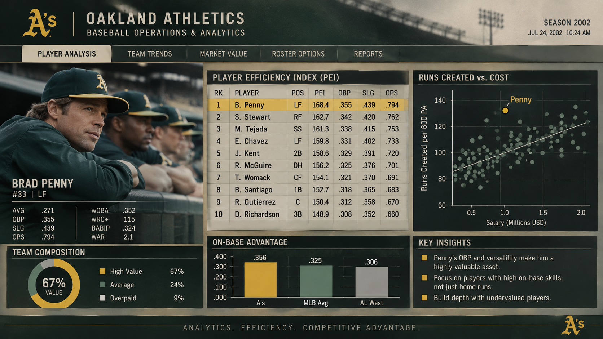

# ⚾ Moneyball Analytics Platform

[](https://python.org)
[](https://streamlit.io)
[](https://plotly.com)
[](https://scikit-learn.org)
[](https://github.com/daivasukrti9)
[](LICENSE)

> **Professional Data Science, Probability, Statistics & Sabermetrics Portfolio Project.**  
> *Developed by **daivasukrti9.***  
> Faithful interactive recreation of the quantitative baseball operations terminal deployed by Billy Beane and Paul DePodesta with the 2002 Oakland Athletics, fully scalable across the modern era of Major League Baseball (1960–2023).

<p align="center">
  
</p>

---

## 🎯 Central Hypothesis & Philosophy

> *"We are not buying players; we are buying wins. And to buy wins, we buy runs."*  
> — **Billy Beane / Peter Brand (Moneyball)**

The scarcest and most finite asset in baseball is **27 outs per game**. The 2002 Oakland Athletics demonstrated a profound structural inefficiency in the Major League Baseball labor market:
1. **Batting Average (AVG) was heavily overvalued**, failing to recognize that a base on balls (BB) avoids an out just as effectively as a single.
2. **On-Base Percentage (OBP)** and **Slugging (SLG)** possess direct mathematical correlation with net run production.
3. On a shoestring payroll of just **$40,004,167 USD** (28th of 30 MLB franchises), Oakland won **103 regular-season games**—including a historic 20-game winning streak—matching the New York Yankees ($125,928,583 USD payroll) at **3.14x the salary efficiency per win**.

---

## 🚀 1-Click Execution & Cloud Deployment

### Option 1: Instant Local Launch (Windows 1-Click)
Double-click:
```bash
run.bat
```
The batch script automatically verifies the Python virtual environment and opens the terminal dashboard in your default browser at `http://localhost:8501`.

### Option 2: Command Line with `uv`
```bash
# Run the interactive dashboard
uv run streamlit run src/app/main.py
```

### Option 3: Instant Cloud Deployment (Streamlit Community Cloud)
1. Push this repository to your **GitHub** profile.
2. Log in to [share.streamlit.io](https://share.streamlit.io).
3. Connect your repository and select the entry point:
   `src/app/main.py`
4. Deploy! Your portfolio demo is live 24/7 with a public SSL URL for your resume, LinkedIn, and client showcase.

---

## 📐 Mathematical Foundations & Formulas

### 1. On-Base Percentage (OBP)
Measures the strict probability that a plate appearance avoids an out:
$$\text{OBP} = \frac{\text{Hits} + \text{BB} + \text{HBP}}{\text{AB} + \text{BB} + \text{HBP} + \text{SF}}$$

### 2. Slugging Percentage (SLG)
Measures the number of total bases earned per official at-bat:
$$\text{SLG} = \frac{\text{1B} + 2\cdot\text{2B} + 3\cdot\text{3B} + 4\cdot\text{HR}}{\text{AB}}$$

### 3. Runs Created (Bill James Basic RC)
$$\text{RC} = \frac{(\text{Hits} + \text{BB}) \times (\text{1B} + 2\cdot\text{2B} + 3\cdot\text{3B} + 4\cdot\text{HR})}{\text{AB} + \text{BB}}$$

### 4. Pythagorean Expectation of Wins (Bill James)
Calculates expected team winning percentage by isolating sequence luck:
$$\text{Win}\% = \frac{\text{Runs Scored}^2}{\text{Runs Scored}^2 + \text{Runs Allowed}^2}$$
$$\text{Expected Wins} = \text{Win}\% \times 162$$

### 5. Linear Regression Run Production Model
Calibrated over decades of historical MLB team data (`src/models/regression.py`):
$$\text{Runs} = -834.99 + 2863.21 \cdot (\text{OBP}) + 1490.41 \cdot (\text{SLG})$$
$$\text{Arbitrage Multiplier} = \frac{\beta_{\text{OBP}}}{\beta_{\text{SLG}}} = \frac{2863.21}{1490.41} \approx 1.92$$
> **Empirical Finding:** Each point of **OBP is worth 1.92x more** than a point of SLG in marginal run manufacturing.

---

## 🏛️ System Architecture

```
Moneyball/
├── src/
│   ├── sabermetrics/
│   │   └── metrics.py       # Vectorized sabermetric math (OBP, SLG, OPS, RC, Pyth)
│   ├── data/
│   │   └── etl.py           # Robust ETL for Lahman Database, Positions & SQLite
│   ├── models/
│   │   └── regression.py    # Scikit-Learn OLS linear model for runs & wins
│   └── app/
│       ├── main.py          # 7-tab terminal interface styled after Oakland 2002
│       └── theme.py         # Visual engine: CRT slate, official MLB logos & styling
├── data/
│   ├── processed/           # Compressed Parquet caches for sub-second startup
│   └── moneyball.db         # Relational SQLite database
├── assets/                  # Official Moneyball vector wordmark
├── tests/                   # Automated unit test suite (6/6 passing)
├── run.bat                  # 1-click Windows runner
├── requirements.txt         # Standard dependencies for cloud hosting
├── pyproject.toml           # Modern package configuration (uv)
└── README.md                # Portfolio presentation
```

---

## 📑 Terminal Tabs Overview

1. **`Ref.`:** Complete sabermetric glossary (`OBP`, `SLG`, `OPS`, `PEI`, `RC`, `RC/600`, `PA`, `AB`, `$/RC`, `Pyth W%`, `GB`), core formulas, ground rules, and architectural guide.
2. **`Player Analysis`:** 1:1 replica of the movie's main terminal screen:
   - **Player Efficiency Index (PEI) Leaderboard:** Ranked hitters (#1 Miguel Tejada highlighted in gold), OBP, SLG, and OPS metrics.
   - **Runs Created vs. Cost Scatter:** Logarithmic salary regression isolating undervalued production, with star highlight indicator for top franchise value.
   - **Key Insights & Probability Model:** Strategic qualitative axioms, game win probability, playoff odds, division standing, and Pythagorean expected wins.
   - **On-Base Advantage & Lineup Options:** Comparative OBP bar chart (Team vs. MLB Avg vs. Division) and projected run generation lineup.
3. **`Scouting`:** BATS Technical Scouting System with custom CRT halftone player portraits:
   - **Player Bio Dossier (Ficha Técnica):** Bio specs (Height, Weight, Bats, Throws, Debut, Salary, $/RC) and PEI efficiency tile, cleanly framed without overflow.
   - **Interactive 3x3 Strike Zone & Pitch Matrix:** Visual pitch outcome markers (`H` hits, `HR` home runs, `S` strikes, `B` balls, `F` fouls), pitch type and inning filters, technical baseball bat with batter handedness badge (`R` / `L`), and pitch breakdown matrix.
   - **Pitchers & Baserunning Modes:** Release zone & pitch velocity profile for pitchers; diamond stolen base path (SB vs CS) and 75% break-even threshold for baserunners.
4. **`Team Trends`:** Full 30-club scatter plot rendering official HD team crests in (Payroll, Wins) space, division standings with games behind (GB), historical spending trends, and OBP vs. Runs correlation.
5. **`Market Value`:** Scouting filters (Min PA, Max Salary, Min OBP, Positions), market inefficiency mapping, and interactive Target Board with multi-row selection to build a Shortlist.
6. **`Roster Options`:** General Manager Lineup Builder: checkbox player pool, 9-hitter card, live runs allowed and budget sliders, projecting expected wins and issuing an operational verdict (`PLAYOFF CALIBER · UNDER BUDGET`).
7. **`Reports`:** Dynamic Roster Turnover & Replacement Analysis (Lost vs Added OBP & Salary from $Y-1 \to Y$ for any franchise/season, with classic Giambi movie case study toggle for Oakland 2002), Executive Season Audit (Record, Run Differential, Pythagorean luck, Payroll & Value ranks), 20-season Monte Carlo simulation calibrated to the team's baseline, and 4-way Front-Office CSV exports.

---

## 👤 Portfolio Attribution
* **Project Author:** `daivasukrti9.`  
* **Field:** Data Science, Quantitative Sports Analytics & Financial Arbitrage  
* **Footer Signature:** `ANALYTICS. EFFICIENCY. COMPETITIVE ADVANTAGE. · by daivasukrti9. ✦ (Gemini)`
