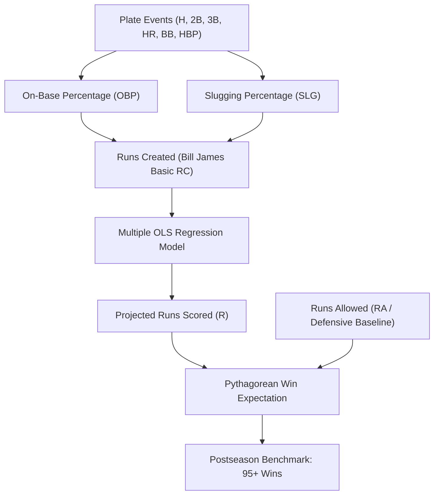

# ⚾ Quantitative Sabermetrics Study, Mathematical Models & Competitive Strategies

**Author:** `daivasukrti9.`  
**Project:** Moneyball Analytics Platform  
**Domain:** Quantitative Sports Modeling, Financial Arbitrage & Applied Probability

---

## 1. Core Foundations & Moneyball Philosophy

### 1.1 Historical and Economic Landscape (MLB 2002)
Unlike North American leagues such as the NFL or NBA, Major League Baseball operates without a hard salary cap. This structural dynamic creates extreme capital disparity:
* **Large-Market Franchises (e.g., New York Yankees, Boston Red Sox):** Annual player payrolls exceeding **$100M – $125M USD**.
* **Small-Market Franchises (e.g., Oakland Athletics, Minnesota Twins):** Budgets constrained to **$35M – $40M USD**.

Following the 2001 season, the Oakland Athletics suffered the departure of their three marquee free agents:
1. **Jason Giambi** (American League MVP, first baseman; signed by the NY Yankees for \$120M).
2. **Johnny Damon** (leadoff center fielder; signed by the Boston Red Sox for \$31M).
3. **Jason Isringhausen** (All-Star closer; signed by the St. Louis Cardinals).

Operating with a total payroll of only **\$40,041,167 USD** (ranking 28th of 30 MLB clubs), General Manager **Billy Beane** and quantitative analyst **Paul DePodesta** recognized that competing in an open auction for individual prestige was impossible. The only mathematically viable strategy was **identifying and exploiting systemic market mispricings**.

### 1.2 The Foundational Axiom
> *"The scarcest and most finite resource in baseball is not money, nor plate appearances: it is the **27 outs** allocated to each team per game. Every offensive event that avoids an out preserves that precious capital. Therefore, we do not buy players; we buy runs, and runs purchase wins."*

---

## 2. Rigorous Mathematical Formulations & Sabermetric Glossary

---

### 2.1 Plate Appearances ($PA$) vs. Official At-Bats ($AB$)
* **Plate Appearance ($PA$):** The absolute count of completed turns in the batter's box.
  $$\text{PA} = \text{AB} + \text{BB} + \text{HBP} + \text{SF} + \text{SH}$$
* **At-Bat ($AB$):** The subset of plate appearances where the batter can earn a hit or be put out without non-chargeable events (walks, hit-by-pitch, sacrifices).
  $$\text{AB} = \text{PA} - (\text{BB} + \text{HBP} + \text{SF} + \text{SH})$$

---

### 2.2 Singles ($1B$) and Total Bases ($TB$)
Historical boxscores often aggregate total hits ($H$). Singles are calculated by subtraction:
$$\text{1B} = \text{H} - (\text{2B} + \text{3B} + \text{HR})$$

**Total Bases ($TB$)** quantify the offensive distance traversed strictly through hits:
$$\text{TB} = \text{1B} + 2(\text{2B}) + 3(\text{3B}) + 4(\text{HR})$$

---

### 2.3 Batting Average ($AVG$) vs. On-Base Percentage ($OBP$)

$$\text{AVG} = \frac{\text{Hits}}{\text{AB}}$$

**Why the Moneyball System Rejects AVG:**
1. It assigns zero value to bases on balls ($BB$), even though a walk advances runners and uses zero outs.
2. It penalizes patient hitters who work deep counts and earn walks instead of swinging at pitch-to-contact offerings outside the strike zone.

**On-Base Percentage ($OBP$):**
Measures the strict probability that an appearance does not surrender an out:
$$\text{OBP} = \frac{\text{H} + \text{BB} + \text{HBP}}{\text{AB} + \text{BB} + \text{HBP} + \text{SF}}$$

* **Historical N/A Sanitation:** Sacrifice Flies ($SF$) were not officially tracked prior to 1954. For seasons $\le 1953$, the ETL applies conditional imputation $SF = 0$ to prevent missing value propagation.
* **Zero-Division Safeguards:** Handled vectorially via `np.where(denominator > 0, numerator / denominator, 0.0)`.

**MLB Reference Benchmarks:**
* Sub-par / Replacement: $< .310$
* League Average: $\approx .320 – .325$
* All-Star Caliber: $.370 – .390$
* Historic Elite: $> .400$ (Barry Bonds 2002: $.582$; Ted Williams 1941: $.553$).

---

### 2.4 Slugging Percentage ($SLG$) and $OPS$

$$\text{SLG} = \frac{\text{TB}}{\text{AB}} = \frac{\text{1B} + 2\cdot\text{2B} + 3\cdot\text{3B} + 4\cdot\text{HR}}{\text{AB}}$$

$$\text{OPS} = \text{OBP} + \text{SLG}$$

Although $OPS$ adds two rates with distinct denominators ($PA$ and $AB$), empirically it exhibits an $R^2 \approx 0.90$ with team run manufacturing, making it an invaluable proxy for overall offensive impact.

---

### 2.5 Runs Created (Bill James Basic $RC$)

Formulated by Bill James, $RC$ captures the dynamic physics of run production: on-base runners (factor A) multiplied by advancing power (factor B) divided by opportunity expenditure (factor C):
$$\text{RC} = \frac{(\text{H} + \text{BB}) \times \text{TB}}{\text{AB} + \text{BB}}$$

**Full Season Rate ($RC/600\text{ PA}$):**
To compare part-time players, platoons, and injured regulars on an equal footing, production is normalized across 600 plate appearances:
$$\text{RC/600} = \frac{\text{RC}}{\text{PA}} \times 600$$

---

### 2.6 Player Efficiency Index ($PEI$)

The $PEI$ metric featured on the primary terminal board indexes a hitter's run production per plate appearance relative to the entire league in that respective season:
$$\text{PEI} = 100 \times \frac{\text{RC}_{\text{player}} / \text{PA}_{\text{player}}}{\text{RC}_{\text{league}} / \text{PA}_{\text{league}}}$$

* **$\text{PEI} = 100$:** Exactly equal to the MLB average.
* **$\text{PEI} > 130$:** MVP-tier offensive efficiency (30% above league average). Miguel Tejada registered $PEI = 130.9$ during his 2002 AL MVP campaign.

---

### 2.7 Pythagorean Expectation of Wins (Bill James)

Isolates true team quality from sequence variance (e.g., winning many 1-run games while losing blowouts):
$$\text{Win}\% = \frac{R^\gamma}{R^\gamma + RA^\gamma}, \quad \text{where } \gamma = 2.0$$

$$\text{Projected Wins} = \text{Win}\% \times \text{Total Games (162)}$$

* **Sequence Luck Differential ($\Delta W$):**
  $$\Delta W = W_{\text{actual}} - W_{\text{pythagorean}}$$
  Teams with $|\Delta W| > 4.0$ typically regress heavily toward their Pythagorean baseline the following season.

---

### 2.8 Linear Regression Run Manufacturing Model

Fitted across modern MLB team seasons (`src/models/regression.py`):
$$R = \beta_0 + \beta_{\text{OBP}} \cdot (\text{OBP}) + \beta_{\text{SLG}} \cdot (\text{SLG})$$

**Calibrated Formula:**
$$R = -834.99 + 2863.21 \cdot (\text{OBP}) + 1490.41 \cdot (\text{SLG})$$

$$\text{Arbitrage Multiplier} = \frac{\beta_{\text{OBP}}}{\beta_{\text{SLG}}} = \frac{2863.21}{1490.41} \approx 1.92$$

> **The Quantitative Edge:** A point of **OBP is worth 1.92 times more** than a point of SLG in marginal run production. Because the 2002 free agent market priced SLG substantially higher than OBP, Oakland exploited this gap to build a 103-win roster on a 28th-ranked payroll.

---

### 2.9 Financial Arbitrage & Efficiency Metrics
* **Cost per Run Created ($\$/RC$):**
  $$\$/RC = \frac{\text{Player Salary}}{\text{Runs Created}}$$
* **Cost per Win ($\$/W$):**
  $$\$/W = \frac{\text{Team Payroll}}{\text{Regular Season Wins}}$$
* **Games Behind ($GB$):**
  $$\text{GB} = \frac{(W_{\text{leader}} - W) + (L - L_{\text{leader}})}{2}$$

---

## 3. Systematic Terminal Audit (Tab by Tab)

| Tab | Label | Calculations & Visualizations | Strategic Action |
| :--- | :--- | :--- | :--- |
| **Tab 0** | **`Ref.`** | • Complete glossary of acronyms, formulas, and MLB benchmarks. • Ground rules of the Beane-James paradigm. • Architecture guide and data sanitation specifications. | Provides instant operational guidance and theoretical grounding directly in the application. |
| **Tab 1** | **`Player Analysis`** | • **1:1 Movie Terminal Overview:** Player Efficiency Index (PEI) leaderboard (#1 Miguel Tejada highlighted in gold), logarithmic Salary vs $RC/600$ scatter with star highlight, Key Insights qualitative axioms, Probability Model (Win Probability, Playoff Odds, GB), Oakland OBP Advantage bar chart, and Lineup Options. | Faithful recreation of the movie's primary analytics screen, instantly evaluating offensive efficiency and run-cost dynamics. |
| **Tab 2** | **`Scouting`** | • **BATS Technical Scouting System:** Player Bio Dossier (Ficha Técnica) with CRT photo, 3x3 interactive strike zone with pitch outcome markers (`H`, `HR`, `S`, `B`, `F`), bat orientation (`R`/`L`), pitch breakdown table, and beveled inset stats. • **Pitching & Baserunning Modes:** Arsenal velocity profile for pitchers; stolen base diamond tracking with 75% break-even rule. | Emulates the technical scouting terminal from the film, analyzing pitch distributions, sweet spots, pitch mechanics, and baserunning discipline. |
| **Tab 3** | **`Team Trends`** | • 30-club scatter plot rendering **high-resolution official team logos** in (Payroll, Wins) space. • Division standings table with records, games behind ($GB$), and payroll. • Multi-year franchise spending vs win totals. • Regression of team OBP vs actual runs scored. | Demonstrates the diminishing returns of raw spending and highlights clubs generating excess wins per dollar. |
| **Tab 4** | **`Market Value`** | • Multi-dimensional scouting filters (Min PA, Max Salary $M, Min OBP, Positions). • Market inefficiency scatter map highlighting undervalued targets. • Interactive Target Board with multi-row selection. • Dynamic Shortlist chips with clean export hooks. | Active scouting environment for uncovering undervalued free agents and trade targets prior to market correction. |
| **Tab 5** | **`Roster Options`** | • Checkbox player pool across MLB, Club, or Shortlist. • 1-Click "Load Club Top 9" button. • Formal 9-hitter lineup card. • Live sliders for Runs Allowed ($RA$) and Salary Budget. • Real-time weighted OBP/SLG computation, run projection, and operational status (`PLAYOFF CALIBER · UNDER BUDGET`). | General Manager simulator: test whether any hypothetical lineup crosses the 95-win playoff threshold within budget constraints. |
| **Tab 6** | **`Reports`** | • Dynamic Roster Turnover & Replacement Analysis (Lost vs Added OBP, SLG, and Salary from $Y-1 \to Y$) across any club and season. • Classic 2001 $\to$ 2002 Moneyball case file toggle for Oakland Athletics. • Executive Season Audit (Record, Run Differential, Pythagorean luck factor, Payroll & Value Ranks). • 20-Season Monte Carlo simulation dynamically calibrated to the club's true OBP. • Front-Office Data Export Center (`Roster.csv`, `Standings.csv`, `Shortlist.csv`, `Lineup.csv`). | Delivers comprehensive executive reporting, empirical sample size proof, and complete CSV data export capability for any franchise and season. |

---

## 4. Competitive Sabermetric Strategies: Theory vs. Practice

### 4.1 Strategies from Moneyball (Oakland A's 2002)

#### Strategy 1: Recreating the Superstar in the Aggregate
* **Theory:** Run production is linear and additive. Replacing a superstar (Jason Giambi, $.477$ OBP, \$120M) does not require signing another \$100M superstar. If three disciplined players (each costing $\le \$1M-\$3M$) produce an aggregate OBP equivalent to or higher than the departed players, team run scoring will remain identical or improve.
* **Practice (Oakland 2001 $\to$ 2002 Data):**
  * *Departed Core:* Jason Giambi ($.477$ OBP), Johnny Damon ($.324$ OBP), Olmedo Saenz ($.291$ OBP) $\to$ **Combined OBP: $.364$**. Total 2002 earnings: **\$18.4M USD**.
  * *Acquired Replacement Core:* Scott Hatteberg ($.374$ OBP for \$900K), David Justice ($.376$ OBP for \$7M; partially subsidized by the Yankees), Jeremy Giambi ($.414$ OBP for \$1.06M) $\to$ **Combined 2002 OBP: $.388$**. Total 2002 cost: **\$8.9M USD**.
  * *Empirical Outcome:* Oakland achieved a **higher on-base rate in 2002 than in 2001 while spending less than half the payroll**.

#### Strategy 2: Arbitrage of Walks ($BB$) over Batting Average ($AVG$)
* **Theory:** Conventional scouts viewed walks as passive and unmarketable. Yet walks do not record an out, force pitchers deep into counts, elevate pitch counts, and tire starting pitching.
* **Practice:** Oakland led the American League with **661 walks in 2002** (4.1 walks per game), forcing opposing bullpens into early action throughout the season.

#### Strategy 3: Eliminating Cognitive Biases in Traditional Scouting
* **Theory:** Scouts succumb to the representativeness heuristic: favoring tall, athletic bodies, fluid swing mechanics, or conventional pitch delivery over hard statistical productivity.
* **Practice:**
  * **Chad Bradford:** Submarine relief pitcher dismissed by scouts for throwing from below his ankles. Possessed minuscule extra-base hit rates and extreme groundball generation. Delivered a 3.11 ERA across 75.1 innings for \$270K.
  * **Scott Hatteberg:** Catcher with severe nerve damage in his throwing elbow who could no longer throw to second base. Converted to first base solely for his elite strike-zone discipline. Hit the walk-off home run for Oakland's 20th consecutive victory.

#### Strategy 4: Stochastic Patience During Early-Season Variance
* **Theory:** In samples smaller than 100 plate appearances ($PA$), standard error is wide ($\approx \pm .080$). A true .380 OBP hitter can bat .180 strictly due to batted-ball luck.
* **Practice:** In May 2002, Oakland sat at 20–26, in last place in the AL West. The media and manager Art Howe advocated abandoning the model. Beane held firm, knowing the Law of Large Numbers dictates convergence beyond 400 PA. By July, Oakland embarked on a 20-game winning streak and finished with 103 wins.

---

### 4.2 Modern Sabermetric Strategies Observable in the Data

#### Strategy 5: Payroll Floor & Efficiency Ceiling (Tampa Bay Rays / Cleveland Guardians)
* **Mechanism:** Rather than paying \$25M+ for ace starters, modern low-budget clubs employ *openers*, aggressive bullpen leverage indices, and deep 13-pitcher rotations that optimize pitch velocity and spin efficiency per batter faced.

#### Strategy 6: Three True Outcomes (TTO) & Isolated Power ($ISO$)
* **Mechanism:** Batted balls put into play against defensive shifts experience diminished BABIP. Optimizing for home runs, walks, and accepting strikeouts maximizes run manufacturing efficiency:
  $$\text{ISO} = \text{SLG} - \text{AVG} = \frac{\text{2B} + 2\cdot\text{3B} + 3\cdot\text{HR}}{\text{AB}}$$

#### Strategy 7: Fielding Independent Pitching ($FIP$)
* **Mechanism:** Traditional ERA attributes defensive errors and range limitations to the pitcher. $FIP$ isolates true pitching talent:
  $$\text{FIP} = \frac{13\cdot\text{HR} + 3\cdot(\text{BB} + \text{HBP}) - 2\cdot\text{SO}}{\text{IP}} + \text{C}_{\text{league}}$$
* **Practice:** Front offices acquire pitchers with high ERAs but low FIPs at a discount, knowing their outcomes will normalize when paired with superior defensive alignment.

#### Strategy 8: Platoon Optimization (Left/Right Splits)
* **Mechanism:** Left-handed hitters historically demonstrate a 30 to 45 point OBP advantage against right-handed pitchers.
* **Practice:** Pairing a \$1.5M left-handed hitter with a \$1M right-handed hitter in a platoon creates All-Star level production at one-fourth the market price.

---

## 5. Quantitative Benchmark: Oakland Athletics 2002 vs. New York Yankees

| Metric | Oakland Athletics (OAK) | New York Yankees (NYA) | MLB Average |
| :--- | :--- | :--- | :--- |
| **Total Team Payroll** | **\$40,004,167 USD** | \$125,928,583 USD | \$67,500,000 USD |
| **Actual Regular-Season Wins** | **103** | 103 | 81 |
| **Runs Scored ($R$)** | 800 | 897 | 737 |
| **Runs Allowed ($RA$)** | 654 | 697 | 737 |
| **Team On-Base Percentage ($OBP$)** | **.339** | .354 | .323 |
| **Team Slugging Percentage ($SLG$)** | .432 | .455 | .417 |
| **Expected Pythagorean Wins** | **97.1 W** | 100.9 W | 81.0 W |
| **Cost per Win ($\$/W$)** | **\$388,390 USD** | \$1,222,608 USD | \$833,333 USD |
| **Relative Payroll Efficiency** | **3.14x More Efficient** | 1.00x (Baseline) | 1.47x |

---

## 6. Conclusion
The quantitative principles demonstrated by the 2002 Oakland Athletics establish that empirical modeling, probability theory, and disciplined financial arbitrage can consistently dismantle capital advantages in competitive markets. By prioritizing process over short-term noise, sports analytics transforms raw data into an insurmountable operational edge.

**Portfolio Attribution:**  
*Document prepared and curated by **daivasukrti9.***  
*Moneyball Analytics Platform — 2026.*
